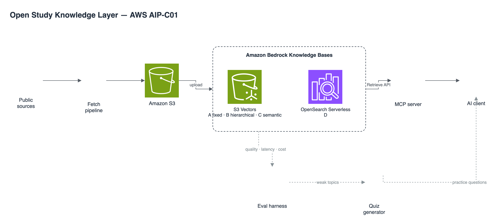

# Open Study Knowledge Layer for the AWS Generative AI Developer Pro Exam

A retrieval setup on Amazon Bedrock Knowledge Bases, with an MCP server in front, built to study for the AWS Generative AI Developer Pro (AIP-C01) exam. The goal is to compare retrieval setups on quality and monthly cost, and to publish everything.

> Status: work in progress. Source fetching is done and verified; the Knowledge Base, MCP server and evaluation are next.

## Scope

- **Public sources only:** AWS docs, whitepapers, the official exam guide, official blogs, samples, pricing and talks, plus my own notes.
- **No exam questions or braindump material.** Ever.
- **Fetched content is not published.** The repo ships manifests and fetch code; `sources/` is gitignored.

## Architecture



Source: [`docs/architecture.drawio`](docs/architecture.drawio) (edit at [diagrams.net](https://app.diagrams.net)).

One shared ingestion pipeline feeds every config. The embedding model is fixed, so only chunking and vector store change between configs.

| Config | Vector store | Chunking |
|--------|--------------|----------|
| A | S3 Vectors | Fixed-size |
| B | S3 Vectors | Hierarchical |
| C | S3 Vectors | Semantic |
| D | OpenSearch Serverless | Best of A/B/C |

## Fetch packages

A `uv` workspace. Each source type is its own package on top of a shared `core` (polite HTTP client with robots.txt, rate limiting, retries and caching; document store; validators; reports).

| Package | Source | Method | Docs fetched |
|---------|--------|--------|--------------|
| `fetch_docs` | AWS service docs, exam guide, Strands Agents docs | per-guide sitemap + `.md` pages, `llms.txt` catalogs | 19,880 |
| `fetch_whitepapers` | Whitepapers and prescriptive guidance | catalog-generated manifests, plus PDF conversion | 1,133 |
| `fetch_blogs` | AWS blogs | blog sitemaps, slug keyword filter, date filter | 1,935 |
| `fetch_guides` | Decision guides, Solutions Library | sitemaps | 45 |
| `fetch_pricing` | AWS Price List | public bulk API, one table per product family | 247 |
| `fetch_samples` | Official AWS GitHub repos | shallow clone, license allow-list, notebooks to markdown | 1,684 |
| `fetch_talks` | Official AWS Events talks | yt-dlp captions, timestamped links | blocked by HTTP 429, see below |

Every document gets YAML frontmatter and a `.metadata.json` sidecar in the Bedrock Knowledge Bases format (source URL, type, collection, exam domains, services, fetch date, content hash).

## Run it

```bash
uv sync --all-packages
uv run aipc01-fetch-docs            # also: -whitepapers -blogs -guides -pricing -samples -talks
uv run aipc01-verify                # integrity check of everything under sources/
uv run pytest packages              # tests
```

Manifests live in `manifests/`. `aipc01-docs-catalog` generates a manifest from any `llms.txt` catalog by keyword.

## Verification

- 24,934 documents, 0 integrity problems (frontmatter, content hash, sidecars, duplicate URLs).
- 40 random pages re-fetched live: 40 identical.
- The fetched exam guide matches a manual copy word for word.
- Known gaps: the `fetch_talks` caption download is rate limited by YouTube (HTTP 429) from my network, so it is built and tested but has no data yet.

## Plan

### 1. Setup
- [ ] Redeem AWS credits, set an AWS Budgets alert
- [ ] Choose region and verify Bedrock model access
- [ ] Set up infrastructure as code (one command to deploy and tear down)
- [ ] Tag all resources per config for cost tracking

### 2. Ingest sources
- [x] Source manifests per source type
- [x] Fetchers with validation, metadata and verification
- [ ] Upload to S3

### 3. Knowledge Bases
- [ ] Create configs A, B, C on S3 Vectors
- [ ] Create config D on OpenSearch Serverless
- [ ] Sync and verify retrieval on each

### 4. MCP server
- [ ] Expose search over all configs
- [ ] Return source citations
- [ ] Test with an AI client

### 5. Evaluation
- [ ] Write a fixed question set from my own notes, with expected source docs
- [ ] Measure retrieval quality (recall@k) and answer quality
- [ ] Measure latency
- [ ] Measure cost: test run and modeled monthly steady state
- [ ] Tear down expensive resources

### 6. Quiz generator
- [ ] Log topics I get wrong
- [ ] Generate practice questions for weak topics from retrieved context

### 7. Publish
- [ ] Clean up code and docs, add license
- [ ] Publish results on AWS Builder Center: what worked, what didn't, what it costs, whether practice scores improved

See [LESSONS_LEARNED.md](LESSONS_LEARNED.md) for decisions and dead ends.

## Disclaimer

Personal project. Not affiliated with or endorsed by AWS. Contains no exam questions or confidential exam content.
